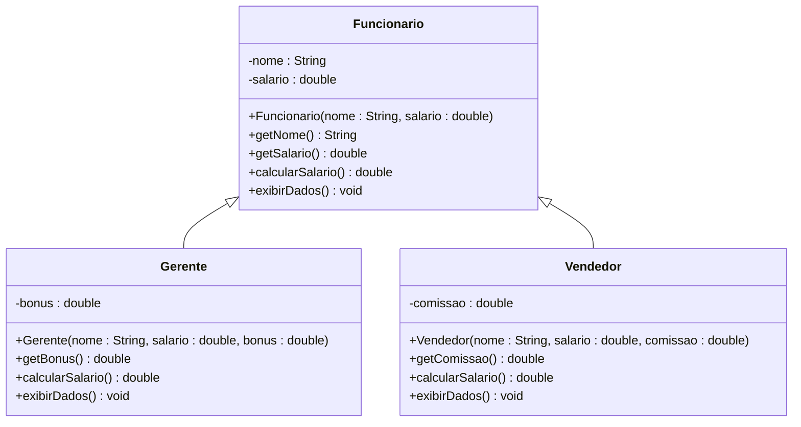
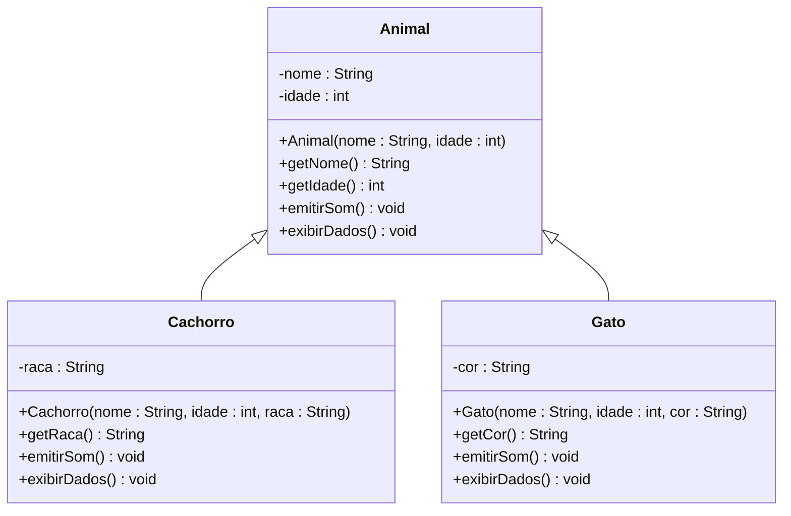
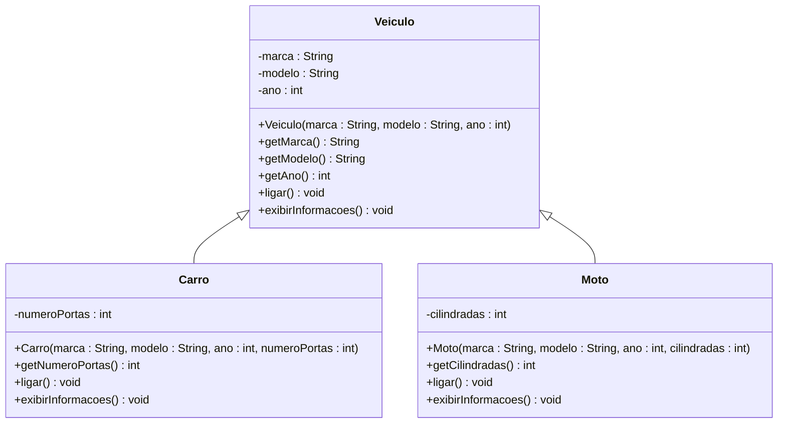
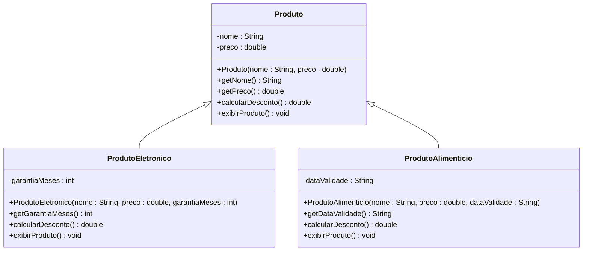
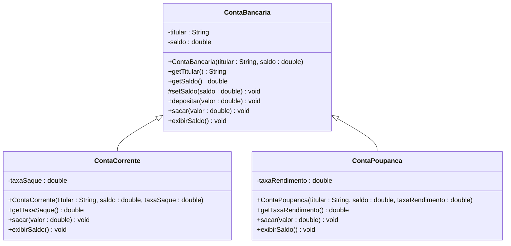
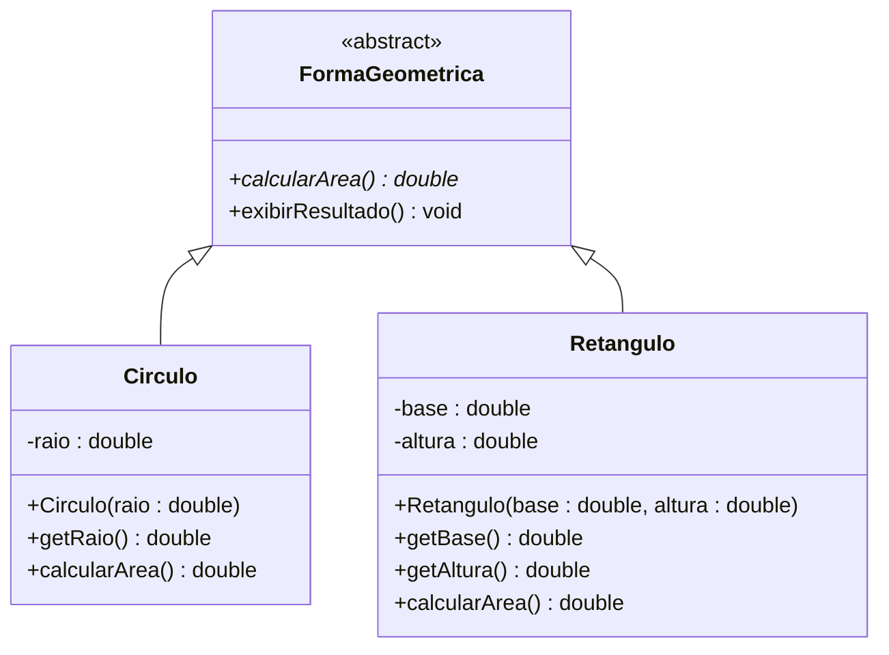
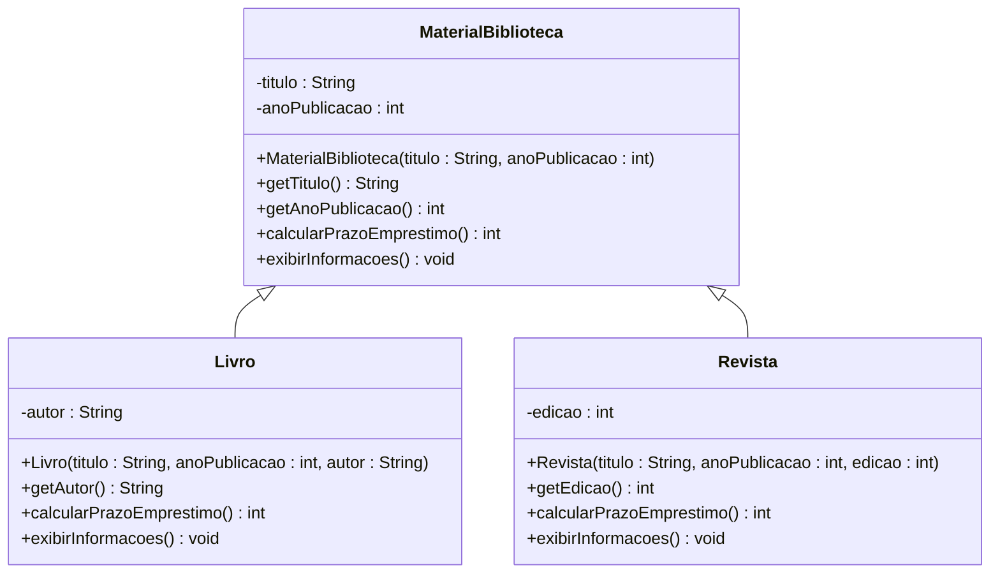
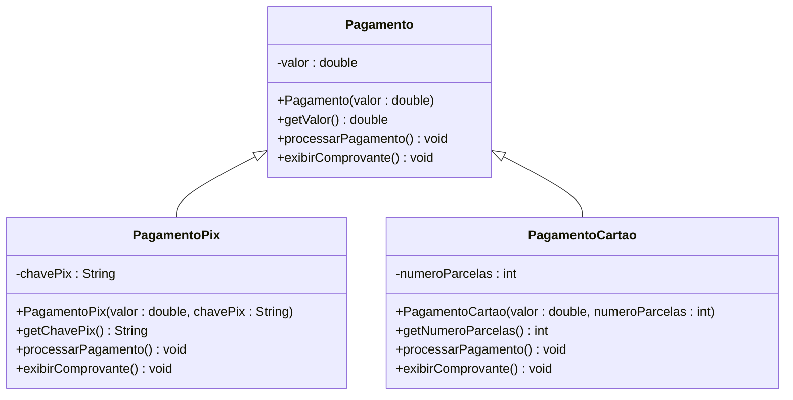
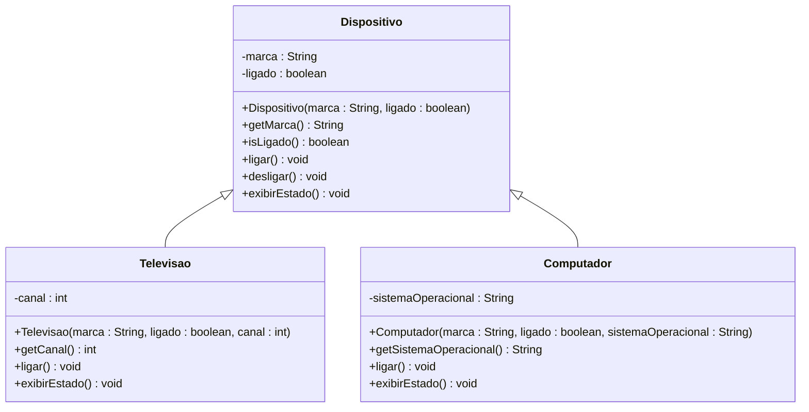
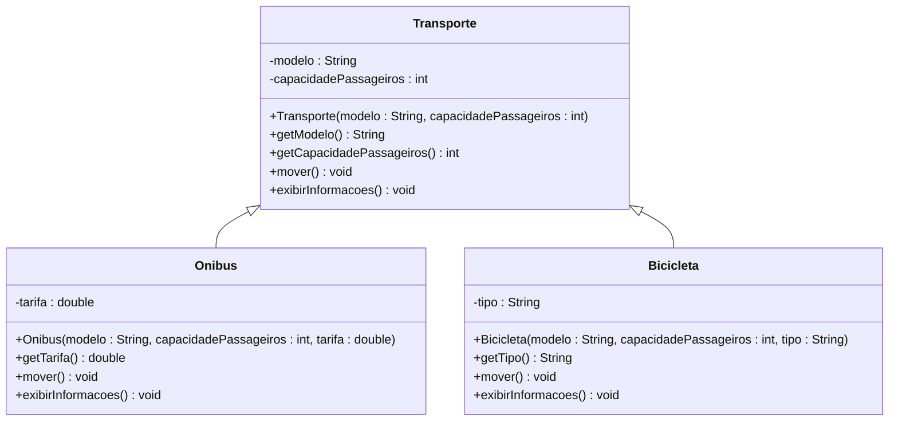

# Atividades de Java — Programação Orientada a Objetos

**UML (Unified Modeling Language), Herança e Noções de Polimorfismo**

**Aluno(a):** _seu nome aqui_

---

## Sumário

- [Atividade 1 — Sistema de Funcionários](#atividade-1--sistema-de-funcionários)
- [Atividade 2 — Sistema de Animais](#atividade-2--sistema-de-animais)
- [Atividade 3 — Sistema de Veículos](#atividade-3--sistema-de-veículos)
- [Atividade 4 — Sistema de Produtos](#atividade-4--sistema-de-produtos)
- [Atividade 5 — Sistema Bancário](#atividade-5--sistema-bancário)
- [Atividade 6 — Sistema de Formas Geométricas](#atividade-6--sistema-de-formas-geométricas)
- [Atividade 7 — Sistema de Biblioteca](#atividade-7--sistema-de-biblioteca)
- [Atividade 8 — Sistema de Pagamentos](#atividade-8--sistema-de-pagamentos)
- [Atividade 9 — Sistema de Dispositivos Eletrônicos](#atividade-9--sistema-de-dispositivos-eletrônicos)
- [Atividade 10 — Sistema de Transporte](#atividade-10--sistema-de-transporte)
- [Atividades 11 a 20 — Questões de concurso e código](#atividades-11-a-20--questões-de-concurso-e-código)
- [Observações](#observações)

## Estrutura do repositório

```text
.
├── README.md
├── atividade-01/
│   ├── Funcionario.java
│   ├── Gerente.java
│   ├── Vendedor.java
│   ├── Main.java
│   └── diagrama-uml.md
├── atividade-02/
│   ├── Animal.java
│   ├── Cachorro.java
│   ├── Gato.java
│   ├── Main.java
│   └── diagrama-uml.md
├── atividade-03/
│   ├── Veiculo.java
│   ├── Carro.java
│   ├── Moto.java
│   ├── Main.java
│   └── diagrama-uml.md
├── atividade-04/
│   ├── Produto.java
│   ├── ProdutoEletronico.java
│   ├── ProdutoAlimenticio.java
│   ├── Main.java
│   └── diagrama-uml.md
├── atividade-05/
│   ├── ContaBancaria.java
│   ├── ContaCorrente.java
│   ├── ContaPoupanca.java
│   ├── Main.java
│   └── diagrama-uml.md
├── atividade-06/
│   ├── FormaGeometrica.java
│   ├── Circulo.java
│   ├── Retangulo.java
│   ├── Main.java
│   └── diagrama-uml.md
├── atividade-07/
│   ├── MaterialBiblioteca.java
│   ├── Livro.java
│   ├── Revista.java
│   ├── Main.java
│   └── diagrama-uml.md
├── atividade-08/
│   ├── Pagamento.java
│   ├── PagamentoPix.java
│   ├── PagamentoCartao.java
│   ├── Main.java
│   └── diagrama-uml.md
├── atividade-09/
│   ├── Dispositivo.java
│   ├── Televisao.java
│   ├── Computador.java
│   ├── Main.java
│   └── diagrama-uml.md
└── atividade-10/
    ├── Transporte.java
    ├── Onibus.java
    ├── Bicicleta.java
    ├── Main.java
    └── diagrama-uml.md
```

## Como compilar e executar

Cada atividade fica em sua própria pasta. Exemplo com a Atividade 1:

```bash
cd atividade-01
javac *.java
java Main
```

## Legenda dos diagramas UML

Os diagramas foram escritos em [Mermaid](https://mermaid.js.org/), que o GitHub renderiza automaticamente. Cada pasta também tem um `diagrama-uml.md` com o mesmo diagrama.

| Símbolo | Significado |
|:-:|---|
| `+` | público |
| `-` | privado |
| `#` | protegido |
| `<\|--` | herança (a seta aponta para a superclasse) |
| `<<abstract>>` | classe abstrata (métodos abstratos aparecem com `*`) |

---

## Atividade 1 — Sistema de Funcionários

**Pasta:** `atividade-01/`  
**Conceitos aplicados:** Herança, construtores com `super`, encapsulamento e sobrescrita de `calcularSalario()` (salário + bônus / salário + comissão).

### Diagrama UML



### Código-fonte

#### `Funcionario.java`

```java
public class Funcionario {
    private String nome;
    private double salario;

    public Funcionario(String nome, double salario) {
        this.nome = nome;
        this.salario = salario;
    }

    public String getNome() { return nome; }

    public double getSalario() { return salario; }

    public double calcularSalario() {
        return salario;
    }

    public void exibirDados() {
        System.out.println("Nome: " + nome);
        System.out.printf("Salário base: R$ %,.2f%n", salario);
        System.out.printf("Salário final: R$ %,.2f%n", calcularSalario());
    }
}
```

#### `Gerente.java`

```java
public class Gerente extends Funcionario {
    private double bonus;

    public Gerente(String nome, double salario, double bonus) {
        super(nome, salario);
        this.bonus = bonus;
    }

    public double getBonus() { return bonus; }

    @Override
    public double calcularSalario() {
        return getSalario() + bonus;
    }

    @Override
    public void exibirDados() {
        System.out.printf("Cargo: Gerente | Bônus: R$ %,.2f%n", bonus);
        super.exibirDados();
    }
}
```

#### `Vendedor.java`

```java
public class Vendedor extends Funcionario {
    private double comissao;

    public Vendedor(String nome, double salario, double comissao) {
        super(nome, salario);
        this.comissao = comissao;
    }

    public double getComissao() { return comissao; }

    @Override
    public double calcularSalario() {
        return getSalario() + comissao;
    }

    @Override
    public void exibirDados() {
        System.out.printf("Cargo: Vendedor | Comissão: R$ %,.2f%n", comissao);
        super.exibirDados();
    }
}
```

#### `Main.java`

```java
public class Main {
    public static void main(String[] args) {
        Gerente gerente = new Gerente("Carlos Almeida", 8000.00, 2500.00);
        Vendedor vendedor = new Vendedor("Ana Souza", 3000.00, 1200.00);

        System.out.println("=== Gerente ===");
        gerente.exibirDados();

        System.out.println();
        System.out.println("=== Vendedor ===");
        vendedor.exibirDados();

        System.out.println();
        System.out.printf("Salário calculado do gerente: R$ %,.2f%n", gerente.calcularSalario());
        System.out.printf("Salário calculado do vendedor: R$ %,.2f%n", vendedor.calcularSalario());
    }
}
```

### Saída no terminal

```text
=== Gerente ===
Cargo: Gerente | Bônus: R$ 2.500,00
Nome: Carlos Almeida
Salário base: R$ 8.000,00
Salário final: R$ 10.500,00

=== Vendedor ===
Cargo: Vendedor | Comissão: R$ 1.200,00
Nome: Ana Souza
Salário base: R$ 3.000,00
Salário final: R$ 4.200,00

Salário calculado do gerente: R$ 10.500,00
Salário calculado do vendedor: R$ 4.200,00
```

---

## Atividade 2 — Sistema de Animais

**Pasta:** `atividade-02/`  
**Conceitos aplicados:** Herança e sobrescrita de `emitirSom()` ("Au au!" e "Miau!") e de `exibirDados()`.

### Diagrama UML



### Código-fonte

#### `Animal.java`

```java
public class Animal {
    private String nome;
    private int idade;

    public Animal(String nome, int idade) {
        this.nome = nome;
        this.idade = idade;
    }

    public String getNome() { return nome; }

    public int getIdade() { return idade; }

    public void emitirSom() {
        System.out.println("Som de animal");
    }

    public void exibirDados() {
        System.out.println("Nome: " + nome);
        System.out.println("Idade: " + idade + " ano(s)");
    }
}
```

#### `Cachorro.java`

```java
public class Cachorro extends Animal {
    private String raca;

    public Cachorro(String nome, int idade, String raca) {
        super(nome, idade);
        this.raca = raca;
    }

    public String getRaca() { return raca; }

    @Override
    public void emitirSom() {
        System.out.println("Au au!");
    }

    @Override
    public void exibirDados() {
        super.exibirDados();
        System.out.println("Raça: " + raca);
    }
}
```

#### `Gato.java`

```java
public class Gato extends Animal {
    private String cor;

    public Gato(String nome, int idade, String cor) {
        super(nome, idade);
        this.cor = cor;
    }

    public String getCor() { return cor; }

    @Override
    public void emitirSom() {
        System.out.println("Miau!");
    }

    @Override
    public void exibirDados() {
        super.exibirDados();
        System.out.println("Cor: " + cor);
    }
}
```

#### `Main.java`

```java
public class Main {
    public static void main(String[] args) {
        Cachorro cachorro = new Cachorro("Rex", 4, "Labrador");
        Gato gato = new Gato("Mimi", 2, "Cinza");

        System.out.println("=== Cachorro ===");
        cachorro.exibirDados();
        System.out.print("Som: ");
        cachorro.emitirSom();

        System.out.println();
        System.out.println("=== Gato ===");
        gato.exibirDados();
        System.out.print("Som: ");
        gato.emitirSom();
    }
}
```

### Saída no terminal

```text
=== Cachorro ===
Nome: Rex
Idade: 4 ano(s)
Raça: Labrador
Som: Au au!

=== Gato ===
Nome: Mimi
Idade: 2 ano(s)
Cor: Cinza
Som: Miau!
```

---

## Atividade 3 — Sistema de Veículos

**Pasta:** `atividade-03/`  
**Conceitos aplicados:** Herança e sobrescrita de `ligar()` ("Carro ligado!" e "Moto ligada!") e de `exibirInformacoes()`.

### Diagrama UML



### Código-fonte

#### `Veiculo.java`

```java
public class Veiculo {
    private String marca;
    private String modelo;
    private int ano;

    public Veiculo(String marca, String modelo, int ano) {
        this.marca = marca;
        this.modelo = modelo;
        this.ano = ano;
    }

    public String getMarca() { return marca; }

    public String getModelo() { return modelo; }

    public int getAno() { return ano; }

    public void ligar() {
        System.out.println("Veículo ligado!");
    }

    public void exibirInformacoes() {
        System.out.println("Marca: " + marca);
        System.out.println("Modelo: " + modelo);
        System.out.println("Ano: " + ano);
    }
}
```

#### `Carro.java`

```java
public class Carro extends Veiculo {
    private int numeroPortas;

    public Carro(String marca, String modelo, int ano, int numeroPortas) {
        super(marca, modelo, ano);
        this.numeroPortas = numeroPortas;
    }

    public int getNumeroPortas() { return numeroPortas; }

    @Override
    public void ligar() {
        System.out.println("Carro ligado!");
    }

    @Override
    public void exibirInformacoes() {
        super.exibirInformacoes();
        System.out.println("Número de portas: " + numeroPortas);
    }
}
```

#### `Moto.java`

```java
public class Moto extends Veiculo {
    private int cilindradas;

    public Moto(String marca, String modelo, int ano, int cilindradas) {
        super(marca, modelo, ano);
        this.cilindradas = cilindradas;
    }

    public int getCilindradas() { return cilindradas; }

    @Override
    public void ligar() {
        System.out.println("Moto ligada!");
    }

    @Override
    public void exibirInformacoes() {
        super.exibirInformacoes();
        System.out.println("Cilindradas: " + cilindradas + " cc");
    }
}
```

#### `Main.java`

```java
public class Main {
    public static void main(String[] args) {
        Carro carro = new Carro("Toyota", "Corolla", 2022, 4);
        Moto moto = new Moto("Honda", "CG 160", 2023, 160);

        System.out.println("=== Carro ===");
        carro.exibirInformacoes();
        carro.ligar();

        System.out.println();
        System.out.println("=== Moto ===");
        moto.exibirInformacoes();
        moto.ligar();
    }
}
```

### Saída no terminal

```text
=== Carro ===
Marca: Toyota
Modelo: Corolla
Ano: 2022
Número de portas: 4
Carro ligado!

=== Moto ===
Marca: Honda
Modelo: CG 160
Ano: 2023
Cilindradas: 160 cc
Moto ligada!
```

---

## Atividade 4 — Sistema de Produtos

**Pasta:** `atividade-04/`  
**Conceitos aplicados:** Sobrescrita de `calcularDesconto()`: 10% para eletrônicos e 5% para alimentícios. A superclasse usa o método sobrescrito para calcular o preço final.

### Diagrama UML



### Código-fonte

#### `Produto.java`

```java
public class Produto {
    private String nome;
    private double preco;

    public Produto(String nome, double preco) {
        this.nome = nome;
        this.preco = preco;
    }

    public String getNome() { return nome; }

    public double getPreco() { return preco; }

    public double calcularDesconto() {
        return 0.0;
    }

    public void exibirProduto() {
        double desconto = calcularDesconto();
        System.out.println("Produto: " + nome);
        System.out.printf("Preço original: R$ %,.2f%n", preco);
        System.out.printf("Desconto: R$ %,.2f%n", desconto);
        System.out.printf("Preço final: R$ %,.2f%n", preco - desconto);
    }
}
```

#### `ProdutoEletronico.java`

```java
public class ProdutoEletronico extends Produto {
    private int garantiaMeses;

    public ProdutoEletronico(String nome, double preco, int garantiaMeses) {
        super(nome, preco);
        this.garantiaMeses = garantiaMeses;
    }

    public int getGarantiaMeses() { return garantiaMeses; }

    @Override
    public double calcularDesconto() {
        return getPreco() * 0.10;
    }

    @Override
    public void exibirProduto() {
        super.exibirProduto();
        System.out.println("Garantia: " + garantiaMeses + " meses");
    }
}
```

#### `ProdutoAlimenticio.java`

```java
public class ProdutoAlimenticio extends Produto {
    private String dataValidade;

    public ProdutoAlimenticio(String nome, double preco, String dataValidade) {
        super(nome, preco);
        this.dataValidade = dataValidade;
    }

    public String getDataValidade() { return dataValidade; }

    @Override
    public double calcularDesconto() {
        return getPreco() * 0.05;
    }

    @Override
    public void exibirProduto() {
        super.exibirProduto();
        System.out.println("Validade: " + dataValidade);
    }
}
```

#### `Main.java`

```java
public class Main {
    public static void main(String[] args) {
        ProdutoEletronico notebook = new ProdutoEletronico("Notebook", 3500.00, 24);
        ProdutoEletronico smartphone = new ProdutoEletronico("Smartphone", 2000.00, 12);
        ProdutoAlimenticio arroz = new ProdutoAlimenticio("Arroz 5 kg", 30.00, "20/12/2026");
        ProdutoAlimenticio chocolate = new ProdutoAlimenticio("Chocolate", 8.00, "30/06/2027");

        System.out.println("=== Produtos Eletrônicos (10% de desconto) ===");
        notebook.exibirProduto();
        System.out.println();
        smartphone.exibirProduto();

        System.out.println();
        System.out.println("=== Produtos Alimentícios (5% de desconto) ===");
        arroz.exibirProduto();
        System.out.println();
        chocolate.exibirProduto();
    }
}
```

### Saída no terminal

```text
=== Produtos Eletrônicos (10% de desconto) ===
Produto: Notebook
Preço original: R$ 3.500,00
Desconto: R$ 350,00
Preço final: R$ 3.150,00
Garantia: 24 meses

Produto: Smartphone
Preço original: R$ 2.000,00
Desconto: R$ 200,00
Preço final: R$ 1.800,00
Garantia: 12 meses

=== Produtos Alimentícios (5% de desconto) ===
Produto: Arroz 5 kg
Preço original: R$ 30,00
Desconto: R$ 1,50
Preço final: R$ 28,50
Validade: 20/12/2026

Produto: Chocolate
Preço original: R$ 8,00
Desconto: R$ 0,40
Preço final: R$ 7,60
Validade: 30/06/2027
```

---

## Atividade 5 — Sistema Bancário

**Pasta:** `atividade-05/`  
**Conceitos aplicados:** Encapsulamento forte: o saldo só muda por `depositar()`/`sacar()`, nunca fica negativo e só aceita valores positivos. A conta corrente cobra taxa por saque; a poupança não.

### Diagrama UML



### Código-fonte

#### `ContaBancaria.java`

```java
public class ContaBancaria {
    private String titular;
    private double saldo;

    public ContaBancaria(String titular, double saldo) {
        this.titular = titular;
        this.saldo = saldo >= 0 ? saldo : 0;
    }

    public String getTitular() { return titular; }

    public double getSaldo() { return saldo; }

    // Protegido: só as subclasses alteram o saldo, e ele nunca fica negativo.
    protected void setSaldo(double saldo) {
        if (saldo >= 0) {
            this.saldo = saldo;
        }
    }

    public void depositar(double valor) {
        if (valor <= 0) {
            System.out.println("Depósito recusado: o valor deve ser positivo.");
            return;
        }
        setSaldo(saldo + valor);
        System.out.printf("Depósito de R$ %,.2f realizado.%n", valor);
    }

    public void sacar(double valor) {
        if (valor <= 0) {
            System.out.println("Saque recusado: o valor deve ser positivo.");
            return;
        }
        if (valor > saldo) {
            System.out.println("Saque recusado: saldo insuficiente.");
            return;
        }
        setSaldo(saldo - valor);
        System.out.printf("Saque de R$ %,.2f realizado.%n", valor);
    }

    public void exibirSaldo() {
        System.out.printf("Titular: %s | Saldo: R$ %,.2f%n", titular, saldo);
    }
}
```

#### `ContaCorrente.java`

```java
public class ContaCorrente extends ContaBancaria {
    private double taxaSaque;

    public ContaCorrente(String titular, double saldo, double taxaSaque) {
        super(titular, saldo);
        this.taxaSaque = taxaSaque;
    }

    public double getTaxaSaque() { return taxaSaque; }

    @Override
    public void sacar(double valor) {
        if (valor <= 0) {
            System.out.println("Saque recusado: o valor deve ser positivo.");
            return;
        }
        double total = valor + taxaSaque;
        if (total > getSaldo()) {
            System.out.printf("Saque recusado: saldo insuficiente (saque de R$ %,.2f + taxa de R$ %,.2f).%n",
                    valor, taxaSaque);
            return;
        }
        setSaldo(getSaldo() - total);
        System.out.printf("Saque de R$ %,.2f realizado (taxa de R$ %,.2f cobrada).%n", valor, taxaSaque);
    }

    @Override
    public void exibirSaldo() {
        super.exibirSaldo();
        System.out.printf("Tipo: Conta Corrente | Taxa por saque: R$ %,.2f%n", taxaSaque);
    }
}
```

#### `ContaPoupanca.java`

```java
public class ContaPoupanca extends ContaBancaria {
    private double taxaRendimento;

    public ContaPoupanca(String titular, double saldo, double taxaRendimento) {
        super(titular, saldo);
        this.taxaRendimento = taxaRendimento;
    }

    public double getTaxaRendimento() { return taxaRendimento; }

    @Override
    public void sacar(double valor) {
        // Poupança não cobra taxa: reaproveita a regra da superclasse.
        super.sacar(valor);
    }

    @Override
    public void exibirSaldo() {
        super.exibirSaldo();
        System.out.printf("Tipo: Conta Poupança | Rendimento: %.2f%% ao mês%n", taxaRendimento * 100);
    }
}
```

#### `Main.java`

```java
public class Main {
    public static void main(String[] args) {
        ContaCorrente corrente = new ContaCorrente("Maria Silva", 1000.00, 2.50);
        ContaPoupanca poupanca = new ContaPoupanca("João Souza", 2000.00, 0.005);

        System.out.println("=== Conta Corrente ===");
        corrente.exibirSaldo();
        corrente.depositar(500.00);
        corrente.sacar(200.00);
        corrente.sacar(5000.00);
        corrente.depositar(-50.00);
        corrente.exibirSaldo();

        System.out.println();
        System.out.println("=== Conta Poupança ===");
        poupanca.exibirSaldo();
        poupanca.depositar(300.00);
        poupanca.sacar(500.00);
        poupanca.sacar(-100.00);
        poupanca.sacar(5000.00);
        poupanca.exibirSaldo();
    }
}
```

### Saída no terminal

```text
=== Conta Corrente ===
Titular: Maria Silva | Saldo: R$ 1.000,00
Tipo: Conta Corrente | Taxa por saque: R$ 2,50
Depósito de R$ 500,00 realizado.
Saque de R$ 200,00 realizado (taxa de R$ 2,50 cobrada).
Saque recusado: saldo insuficiente (saque de R$ 5.000,00 + taxa de R$ 2,50).
Depósito recusado: o valor deve ser positivo.
Titular: Maria Silva | Saldo: R$ 1.297,50
Tipo: Conta Corrente | Taxa por saque: R$ 2,50

=== Conta Poupança ===
Titular: João Souza | Saldo: R$ 2.000,00
Tipo: Conta Poupança | Rendimento: 0,50% ao mês
Depósito de R$ 300,00 realizado.
Saque de R$ 500,00 realizado.
Saque recusado: o valor deve ser positivo.
Saque recusado: saldo insuficiente.
Titular: João Souza | Saldo: R$ 1.800,00
Tipo: Conta Poupança | Rendimento: 0,50% ao mês
```

---

## Atividade 6 — Sistema de Formas Geométricas

**Pasta:** `atividade-06/`  
**Conceitos aplicados:** Classe abstrata com método abstrato `calcularArea()`, implementado em cada subclasse. `exibirResultado()` é concreto e reaproveitado pelas duas formas.

### Diagrama UML



### Código-fonte

#### `FormaGeometrica.java`

```java
public abstract class FormaGeometrica {

    public abstract double calcularArea();

    public void exibirResultado() {
        System.out.printf("Área do %s: %,.2f%n", getClass().getSimpleName(), calcularArea());
    }
}
```

#### `Circulo.java`

```java
public class Circulo extends FormaGeometrica {
    private double raio;

    public Circulo(double raio) {
        this.raio = raio;
    }

    public double getRaio() { return raio; }

    @Override
    public double calcularArea() {
        return Math.PI * raio * raio;
    }
}
```

#### `Retangulo.java`

```java
public class Retangulo extends FormaGeometrica {
    private double base;
    private double altura;

    public Retangulo(double base, double altura) {
        this.base = base;
        this.altura = altura;
    }

    public double getBase() { return base; }

    public double getAltura() { return altura; }

    @Override
    public double calcularArea() {
        return base * altura;
    }
}
```

#### `Main.java`

```java
public class Main {
    public static void main(String[] args) {
        Circulo circulo = new Circulo(5.0);
        Retangulo retangulo = new Retangulo(4.0, 6.5);

        circulo.exibirResultado();
        retangulo.exibirResultado();
    }
}
```

### Saída no terminal

```text
Área do Circulo: 78,54
Área do Retangulo: 26,00
```

---

## Atividade 7 — Sistema de Biblioteca

**Pasta:** `atividade-07/`  
**Conceitos aplicados:** Sobrescrita de `calcularPrazoEmprestimo()`: 14 dias para livros e 7 dias para revistas.

### Diagrama UML



### Código-fonte

#### `MaterialBiblioteca.java`

```java
public class MaterialBiblioteca {
    private String titulo;
    private int anoPublicacao;

    public MaterialBiblioteca(String titulo, int anoPublicacao) {
        this.titulo = titulo;
        this.anoPublicacao = anoPublicacao;
    }

    public String getTitulo() { return titulo; }

    public int getAnoPublicacao() { return anoPublicacao; }

    public int calcularPrazoEmprestimo() {
        return 7;
    }

    public void exibirInformacoes() {
        System.out.println("Título: " + titulo);
        System.out.println("Ano de publicação: " + anoPublicacao);
        System.out.println("Prazo de empréstimo: " + calcularPrazoEmprestimo() + " dias");
    }
}
```

#### `Livro.java`

```java
public class Livro extends MaterialBiblioteca {
    private String autor;

    public Livro(String titulo, int anoPublicacao, String autor) {
        super(titulo, anoPublicacao);
        this.autor = autor;
    }

    public String getAutor() { return autor; }

    @Override
    public int calcularPrazoEmprestimo() {
        return 14;
    }

    @Override
    public void exibirInformacoes() {
        super.exibirInformacoes();
        System.out.println("Autor: " + autor);
    }
}
```

#### `Revista.java`

```java
public class Revista extends MaterialBiblioteca {
    private int edicao;

    public Revista(String titulo, int anoPublicacao, int edicao) {
        super(titulo, anoPublicacao);
        this.edicao = edicao;
    }

    public int getEdicao() { return edicao; }

    @Override
    public int calcularPrazoEmprestimo() {
        return 7;
    }

    @Override
    public void exibirInformacoes() {
        super.exibirInformacoes();
        System.out.println("Edição: " + edicao);
    }
}
```

#### `Main.java`

```java
public class Main {
    public static void main(String[] args) {
        Livro livro1 = new Livro("Dom Casmurro", 1899, "Machado de Assis");
        Livro livro2 = new Livro("Capitães da Areia", 1937, "Jorge Amado");
        Revista revista1 = new Revista("Superinteressante", 2025, 462);
        Revista revista2 = new Revista("Ciência Hoje", 2024, 389);

        System.out.println("=== Livros ===");
        livro1.exibirInformacoes();
        System.out.println();
        livro2.exibirInformacoes();

        System.out.println();
        System.out.println("=== Revistas ===");
        revista1.exibirInformacoes();
        System.out.println();
        revista2.exibirInformacoes();
    }
}
```

### Saída no terminal

```text
=== Livros ===
Título: Dom Casmurro
Ano de publicação: 1899
Prazo de empréstimo: 14 dias
Autor: Machado de Assis

Título: Capitães da Areia
Ano de publicação: 1937
Prazo de empréstimo: 14 dias
Autor: Jorge Amado

=== Revistas ===
Título: Superinteressante
Ano de publicação: 2025
Prazo de empréstimo: 7 dias
Edição: 462

Título: Ciência Hoje
Ano de publicação: 2024
Prazo de empréstimo: 7 dias
Edição: 389
```

---

## Atividade 8 — Sistema de Pagamentos

**Pasta:** `atividade-08/`  
**Conceitos aplicados:** Sobrescrita de `processarPagamento()` e de `exibirComprovante()` em cada forma de pagamento.

### Diagrama UML



### Código-fonte

#### `Pagamento.java`

```java
public class Pagamento {
    private double valor;

    public Pagamento(double valor) {
        this.valor = valor;
    }

    public double getValor() { return valor; }

    public void processarPagamento() {
        System.out.println("Pagamento processado.");
    }

    public void exibirComprovante() {
        System.out.println("----- COMPROVANTE -----");
        System.out.printf("Valor: R$ %,.2f%n", valor);
    }
}
```

#### `PagamentoPix.java`

```java
public class PagamentoPix extends Pagamento {
    private String chavePix;

    public PagamentoPix(double valor, String chavePix) {
        super(valor);
        this.chavePix = chavePix;
    }

    public String getChavePix() { return chavePix; }

    @Override
    public void processarPagamento() {
        System.out.println("Pagamento via Pix realizado");
    }

    @Override
    public void exibirComprovante() {
        super.exibirComprovante();
        System.out.println("Forma de pagamento: Pix");
        System.out.println("Chave Pix: " + chavePix);
    }
}
```

#### `PagamentoCartao.java`

```java
public class PagamentoCartao extends Pagamento {
    private int numeroParcelas;

    public PagamentoCartao(double valor, int numeroParcelas) {
        super(valor);
        this.numeroParcelas = numeroParcelas > 0 ? numeroParcelas : 1;
    }

    public int getNumeroParcelas() { return numeroParcelas; }

    @Override
    public void processarPagamento() {
        System.out.println("Pagamento via cartão realizado");
    }

    @Override
    public void exibirComprovante() {
        super.exibirComprovante();
        System.out.println("Forma de pagamento: Cartão");
        System.out.printf("Parcelas: %dx de R$ %,.2f%n", numeroParcelas, getValor() / numeroParcelas);
    }
}
```

#### `Main.java`

```java
public class Main {
    public static void main(String[] args) {
        PagamentoPix pix = new PagamentoPix(250.00, "maria@email.com");
        PagamentoCartao cartao = new PagamentoCartao(1200.00, 3);

        System.out.println("=== Pix ===");
        pix.processarPagamento();
        pix.exibirComprovante();

        System.out.println();
        System.out.println("=== Cartão ===");
        cartao.processarPagamento();
        cartao.exibirComprovante();
    }
}
```

### Saída no terminal

```text
=== Pix ===
Pagamento via Pix realizado
----- COMPROVANTE -----
Valor: R$ 250,00
Forma de pagamento: Pix
Chave Pix: maria@email.com

=== Cartão ===
Pagamento via cartão realizado
----- COMPROVANTE -----
Valor: R$ 1.200,00
Forma de pagamento: Cartão
Parcelas: 3x de R$ 400,00
```

---

## Atividade 9 — Sistema de Dispositivos Eletrônicos

**Pasta:** `atividade-09/`  
**Conceitos aplicados:** `ligar()` e `desligar()` implementados na superclasse; `ligar()` é sobrescrito e reaproveita a versão da superclasse com `super.ligar()`.

### Diagrama UML



### Código-fonte

#### `Dispositivo.java`

```java
public class Dispositivo {
    private String marca;
    private boolean ligado;

    public Dispositivo(String marca, boolean ligado) {
        this.marca = marca;
        this.ligado = ligado;
    }

    public String getMarca() { return marca; }

    public boolean isLigado() { return ligado; }

    public void ligar() {
        ligado = true;
        System.out.println("Ligando dispositivo da marca " + marca + "...");
    }

    public void desligar() {
        ligado = false;
        System.out.println("Dispositivo da marca " + marca + " desligado.");
    }

    public void exibirEstado() {
        System.out.println("Marca: " + marca);
        System.out.println("Estado: " + (ligado ? "Ligado" : "Desligado"));
    }
}
```

#### `Televisao.java`

```java
public class Televisao extends Dispositivo {
    private int canal;

    public Televisao(String marca, boolean ligado, int canal) {
        super(marca, ligado);
        this.canal = canal;
    }

    public int getCanal() { return canal; }

    @Override
    public void ligar() {
        super.ligar();
        System.out.println("Televisão ligada no canal informado: " + canal);
    }

    @Override
    public void exibirEstado() {
        super.exibirEstado();
        System.out.println("Canal: " + canal);
    }
}
```

#### `Computador.java`

```java
public class Computador extends Dispositivo {
    private String sistemaOperacional;

    public Computador(String marca, boolean ligado, String sistemaOperacional) {
        super(marca, ligado);
        this.sistemaOperacional = sistemaOperacional;
    }

    public String getSistemaOperacional() { return sistemaOperacional; }

    @Override
    public void ligar() {
        super.ligar();
        System.out.println("Computador iniciando o sistema operacional: " + sistemaOperacional);
    }

    @Override
    public void exibirEstado() {
        super.exibirEstado();
        System.out.println("Sistema operacional: " + sistemaOperacional);
    }
}
```

#### `Main.java`

```java
public class Main {
    public static void main(String[] args) {
        Televisao tv = new Televisao("Samsung", false, 5);
        Computador pc = new Computador("Dell", false, "Windows 11");

        System.out.println("=== Televisão ===");
        tv.exibirEstado();
        tv.ligar();
        tv.exibirEstado();
        tv.desligar();
        tv.exibirEstado();

        System.out.println();
        System.out.println("=== Computador ===");
        pc.exibirEstado();
        pc.ligar();
        pc.exibirEstado();
        pc.desligar();
        pc.exibirEstado();
    }
}
```

### Saída no terminal

```text
=== Televisão ===
Marca: Samsung
Estado: Desligado
Canal: 5
Ligando dispositivo da marca Samsung...
Televisão ligada no canal informado: 5
Marca: Samsung
Estado: Ligado
Canal: 5
Dispositivo da marca Samsung desligado.
Marca: Samsung
Estado: Desligado
Canal: 5

=== Computador ===
Marca: Dell
Estado: Desligado
Sistema operacional: Windows 11
Ligando dispositivo da marca Dell...
Computador iniciando o sistema operacional: Windows 11
Marca: Dell
Estado: Ligado
Sistema operacional: Windows 11
Dispositivo da marca Dell desligado.
Marca: Dell
Estado: Desligado
Sistema operacional: Windows 11
```

---

## Atividade 10 — Sistema de Transporte

**Pasta:** `atividade-10/`  
**Conceitos aplicados:** Sobrescrita de `mover()` ("Ônibus transportando passageiros" e "Bicicleta em movimento") e de `exibirInformacoes()`.

### Diagrama UML



### Código-fonte

#### `Transporte.java`

```java
public class Transporte {
    private String modelo;
    private int capacidadePassageiros;

    public Transporte(String modelo, int capacidadePassageiros) {
        this.modelo = modelo;
        this.capacidadePassageiros = capacidadePassageiros;
    }

    public String getModelo() { return modelo; }

    public int getCapacidadePassageiros() { return capacidadePassageiros; }

    public void mover() {
        System.out.println("Transporte em movimento");
    }

    public void exibirInformacoes() {
        System.out.println("Modelo: " + modelo);
        System.out.println("Capacidade: " + capacidadePassageiros + " passageiro(s)");
    }
}
```

#### `Onibus.java`

```java
public class Onibus extends Transporte {
    private double tarifa;

    public Onibus(String modelo, int capacidadePassageiros, double tarifa) {
        super(modelo, capacidadePassageiros);
        this.tarifa = tarifa;
    }

    public double getTarifa() { return tarifa; }

    @Override
    public void mover() {
        System.out.println("Ônibus transportando passageiros");
    }

    @Override
    public void exibirInformacoes() {
        super.exibirInformacoes();
        System.out.printf("Tarifa: R$ %,.2f%n", tarifa);
    }
}
```

#### `Bicicleta.java`

```java
public class Bicicleta extends Transporte {
    private String tipo;

    public Bicicleta(String modelo, int capacidadePassageiros, String tipo) {
        super(modelo, capacidadePassageiros);
        this.tipo = tipo;
    }

    public String getTipo() { return tipo; }

    @Override
    public void mover() {
        System.out.println("Bicicleta em movimento");
    }

    @Override
    public void exibirInformacoes() {
        super.exibirInformacoes();
        System.out.println("Tipo: " + tipo);
    }
}
```

#### `Main.java`

```java
public class Main {
    public static void main(String[] args) {
        Onibus onibus1 = new Onibus("Mercedes-Benz O500", 45, 4.50);
        Onibus onibus2 = new Onibus("Marcopolo Torino", 40, 5.00);
        Bicicleta bicicleta1 = new Bicicleta("Caloi Elite", 1, "Mountain bike");
        Bicicleta bicicleta2 = new Bicicleta("Monark Barra Circular", 1, "Urbana");

        System.out.println("=== Ônibus ===");
        onibus1.exibirInformacoes();
        onibus1.mover();
        System.out.println();
        onibus2.exibirInformacoes();
        onibus2.mover();

        System.out.println();
        System.out.println("=== Bicicletas ===");
        bicicleta1.exibirInformacoes();
        bicicleta1.mover();
        System.out.println();
        bicicleta2.exibirInformacoes();
        bicicleta2.mover();
    }
}
```

### Saída no terminal

```text
=== Ônibus ===
Modelo: Mercedes-Benz O500
Capacidade: 45 passageiro(s)
Tarifa: R$ 4,50
Ônibus transportando passageiros

Modelo: Marcopolo Torino
Capacidade: 40 passageiro(s)
Tarifa: R$ 5,00
Ônibus transportando passageiros

=== Bicicletas ===
Modelo: Caloi Elite
Capacidade: 1 passageiro(s)
Tipo: Mountain bike
Bicicleta em movimento

Modelo: Monark Barra Circular
Capacidade: 1 passageiro(s)
Tipo: Urbana
Bicicleta em movimento
```

---

## Atividades 11 a 20 — Questões de concurso e código

### Gabarito

| Atividade | Banca / Tipo | Resposta |
|:-:|---|:-:|
| 11 | Estilo FCC — 2020 | **b)** |
| 12 | Estilo FGV — 2023 | **c)** |
| 13 | Estilo VUNESP — 2022 | **e)** |
| 14 | Estilo Instituto AOCP — 2024 | **a)** |
| 15 | Estilo Cebraspe — 2021 | **d)** |
| 16 | Estilo FCC — 2022 | **b)** |
| 17 | Estilo FGV — 2023 | **c)** |
| 18 | Estilo VUNESP — 2024 | **a)** |
| 19 | Estilo Instituto Quadrix — 2023 | **e)** |
| 20 | Código Java — `Animal` e `Cachorro` | **b)** |

### Atividade 11 — Estilo FCC — 2020

> Na programação orientada a objetos, uma classe pode ser compreendida como…

**Resposta: b)** Um modelo que define atributos e comportamentos de objetos.

**Justificativa:** A classe é o molde (a “planta”) a partir do qual os objetos são criados: ela declara os atributos (estado) e os métodos (comportamento). A alternativa **a** descreve um *objeto* (instância), e as demais não têm relação com o conceito de classe.

### Atividade 12 — Estilo FGV — 2023

> O atributo `saldo` só pode ser alterado pelos métodos `depositar()` e `sacar()`. Isso representa principalmente…

**Resposta: c)** Encapsulamento.

**Justificativa:** Encapsulamento é proteger o estado interno do objeto (atributo `private`) e liberar o acesso apenas por métodos controlados. Herança é reaproveitar uma classe; polimorfismo é um mesmo método com comportamentos diferentes; sobrecarga é o mesmo nome de método com parâmetros diferentes; generalização é a relação “subclasse → superclasse” na UML.

### Atividade 13 — Estilo VUNESP — 2022

> `Professor` e `Aluno` compartilham `nome` e `cpf`, definidos em `Pessoa`. Esse relacionamento caracteriza…

**Resposta: e)** Herança.

**Justificativa:** Professor *é uma* Pessoa e Aluno *é uma* Pessoa (relação “é um”), e ambos reaproveitam os atributos da superclasse. Composição e agregação expressam “tem um” / “é parte de”; dependência e associação simples não implicam reaproveitamento de atributos.

### Atividade 14 — Estilo Instituto AOCP — 2024

> `Cachorro` e `Gato` implementam `emitirSom()` de formas diferentes. O conceito que permite à mesma operação ter comportamentos diferentes conforme o objeto é…

**Resposta: a)** Polimorfismo.

**Justificativa:** Polimorfismo (“muitas formas”) é exatamente a mesma mensagem — `emitirSom()` — produzindo respostas diferentes dependendo do objeto que a recebe, normalmente por sobrescrita de métodos. Normalização, decomposição funcional, persistência e indexação pertencem a outros contextos (banco de dados e análise estruturada).

### Atividade 15 — Estilo Cebraspe — 2021

> Sobre a UML, assinale a alternativa correta.

**Resposta: d)** É uma linguagem visual padronizada utilizada para especificar, visualizar e documentar sistemas.

**Justificativa:** A UML é uma linguagem de **modelagem** (não de programação), padronizada pela OMG, com diversos tipos de diagramas. Ela não substitui Java/Python, não se limita a bancos de dados nem a interfaces gráficas, e não é um compilador.

### Atividade 16 — Estilo FCC — 2022

> Em um diagrama de classes UML, os símbolos `+`, `-` e `#` representam, respectivamente…

**Resposta: b)** Público, privado e protegido.

**Justificativa:** `+` = *public* (público), `-` = *private* (privado) e `#` = *protected* (protegido). Existe ainda o `~`, que indica visibilidade de pacote.

### Atividade 17 — Estilo FGV — 2023

> Classe `Aluno` com `- nome : String`, `- matricula : int`, `+ getNome() : String` e `+ estudar() : void`. É correto afirmar que…

**Resposta: c)** Os atributos são privados e os métodos apresentados são públicos.

**Justificativa:** O `-` indica visibilidade privada para `nome` e `matricula`, e o `+` indica visibilidade pública para os dois métodos. `estudar()` retorna `void` (nada), e `getNome()` é público e retorna `String`.

### Atividade 18 — Estilo VUNESP — 2024

> Um usuário pode realizar vários empréstimos (ou nenhum), e cada empréstimo pertence a um único usuário. Qual a multiplicidade mais adequada?

**Resposta: a)** 1 para 0..*.

**Justificativa:** Do lado de `Usuario` a multiplicidade é **1** (cada empréstimo pertence a exatamente um usuário). Do lado de `Emprestimo` é **0..*** (um usuário pode ter nenhum ou vários empréstimos).

### Atividade 19 — Estilo Instituto Quadrix — 2023

> Assinale a alternativa que relaciona corretamente os diagramas UML às suas finalidades.

**Resposta: e)** Casos de uso: funcionalidades e atores; classes: classes e relacionamentos; sequência: interações ao longo do tempo.

**Justificativa:** Esta é a única alternativa sem palavras como “exclusivamente” ou “apenas” e que descreve corretamente os três diagramas. Nas demais, o diagrama de classes não representa sequência temporal, o de casos de uso não mostra atributos privados, o de sequência não modela a estrutura física do banco e o de atividades não se limita à herança.

### Atividade 20 — Código Java — `Animal` e `Cachorro`

> Com base no código apresentado (`Cachorro extends Animal`, com `@Override` em `emitirSom()`), assinale a alternativa correta.

**Resposta: b)** A classe `Cachorro` herda da classe `Animal` e sobrescreve o método `emitirSom()`, fazendo com que a mensagem "Au au!" seja exibida.

**Justificativa:** O código compila normalmente. `new Cachorro()` cria um objeto da subclasse, e a chamada `cachorro.emitirSom()` executa a versão sobrescrita, imprimindo `Au au!`. A alternativa **a** é falsa (sobrescrita é permitida), **c** é falsa (`extends` cria herança, quem cria objetos é o `new`), **d** é falsa (`@Override` só pede ao compilador que confira a sobrescrita) e **e** é falsa (o método da subclasse tem prioridade).

---

## Observações

- Todos os programas foram compilados e executados; as saídas acima são as reais.
- Todos os atributos são `private`, com métodos `get`. Um `set` só foi criado onde era necessário: `setSaldo()` (protegido) na Atividade 5, para que o saldo nunca fique negativo.
- Os objetos são criados individualmente no `main`, sem vetores nem listas, e a classe `Main` só instancia objetos e chama métodos.
- Nos construtores das subclasses, `super(...)` inicializa os atributos herdados, e todos os métodos sobrescritos usam `@Override`.
- Na Atividade 6, a superclasse abstrata não possui atributos, por isso as subclasses não precisam chamar `super(...)` com argumentos.
- A `dataValidade` (Atividade 4) foi representada como `String` para manter o exemplo simples; em um sistema real, o ideal seria `LocalDate`.
- Os valores em reais saem no formato brasileiro (`1.234,56`) quando o Java roda com o idioma do sistema em português.
